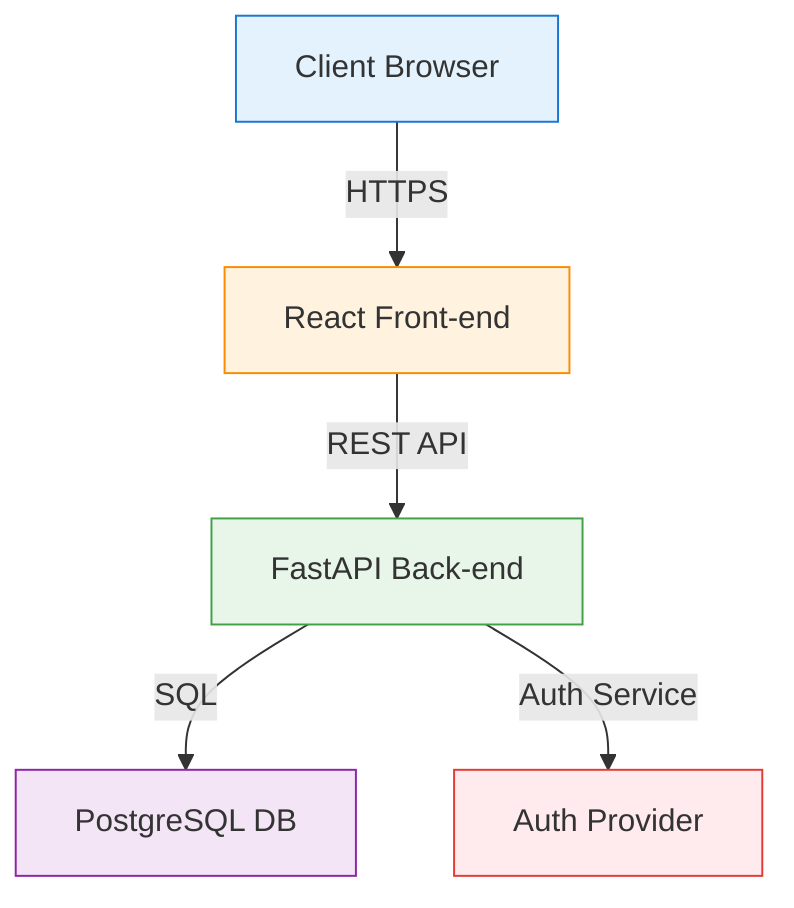

# Ndurance CRM – Project Update Application

## Overview
This repository contains a modern web‑based CRM (Customer Relationship Management) system for managing projects, modules, and employee allocations. The solution is built with a **React + TypeScript** front‑end, a **FastAPI** back‑end, and a PostgreSQL database (or any compatible DB). It follows a RESTful architecture and is container‑ready.

### Table of Contents
1. [Tech Stack](#tech-stack)
2. [Architecture Diagram](#architecture-diagram)
3. [Folder Structure](#folder-structure)
4. [Back‑end API](#backend-api)
5. [Front‑end Components](#frontend-components)
6. [Build & Run Instructions](#build--run-instructions)
7. [Testing](#testing)
8. [Deployment](#deployment)
9. [Glossary](#glossary)

---

## Tech Stack
- **Front‑end**: React 18, TypeScript, Vite, TailwindCSS, Lucide‑react icons
- **State Management**: React hooks (useState, useEffect)
- **Back‑end**: Python 3.11, FastAPI, Pydantic, SQLAlchemy
- **Database**: PostgreSQL (or SQLite for local dev)
- **API Client**: Axios wrapper (`services/api.ts`)
- **Authentication**: Context‑based (`AuthContext`)
- **Testing**: Jest + React Testing Library (front), Pytest (back)
- **Packaging**: npm scripts, Docker

---

## Architecture Diagram

---

## Folder Structure
```
project-root/
├─ backend/                     # FastAPI server
│   ├─ app/
│   │   ├─ api/                # Route definitions (projects.py, users.py …)
│   │   ├─ core/               # Settings, DB, security utilities
│   │   └─ models/             # Pydantic & SQLAlchemy models
│   └─ Dockerfile
├─ frontend/                    # React SPA
│   ├─ src/
│   │   ├─ assets/            # Images, icons
│   │   ├─ components/        # Re‑usable UI widgets (Navbar, Modals …)
│   │   ├─ pages/             # Page‑level components (Home, ProjectUpdate …)
│   │   ├─ services/          # API client wrapper
│   │   ├─ types/             # TypeScript interfaces (ProjectItem, ModuleItem …)
│   │   └─ App.tsx
│   ├─ public/                # index.html, favicon
│   └─ vite.config.ts
├─ docs/                        # Documentation (this folder)
│   ├─ TECHNICAL_DOCUMENTATION.md
│   └─ USER_GUIDE.md
├─ docker-compose.yml           # Multi‑service orchestration
├─ README.md                    # High‑level project description
└─ .gitignore
```
---

## Back‑end API (excerpt)
| Endpoint | Method | Description | Request Body | Response |
|----------|--------|-------------|--------------|----------|
| `/api/projects` | GET | List all projects (paginated) | – | `ProjectItem[]` |
| `/api/projects/{id}` | GET | Retrieve a single project with its modules | – | `ProjectDetail` |
| `/api/projects/{id}` | PUT | Update project fields and its module list | `ProjectUpdatePayload` | Updated `ProjectItem` |
| `/api/users` | GET | List all users (for employee allocation) | – | `User[]` |
| `/api/companies` | GET | List companies (for the dropdown) | – | `Company[]` |

All endpoints are protected by JWT‑based authentication handled in `AuthContext` on the front‑end.
---

## Front‑end Components (key files)
- **`GlobalNavbar.tsx`** – Top navigation bar with branding and user menu.
- **`ProjectUpdatePage.tsx`** – Main UI for editing a project:
  - Shows project information, employee allocation chips, a horizontally scrollable module list, priority slider, status & company selectors, and timeline dates.
  - Modules are clickable; clicking a module navigates to `/modules/{id}`.
  - Action buttons (Complete, Discard, Save) sit below the settings panel.
- **`DeveloperUIEditorModal.tsx`** – Modal for advanced editing of JSON payloads (used by admins).
- **`services/api.ts`** – Centralised Axios instance with interceptors for auth token handling.
- **`types/*.ts`** – TypeScript definitions for Project, Module, User, Company, etc.
---

## Build & Run Instructions
### Prerequisites
- **Node.js 20+** (for front‑end)
- **Python 3.11+** & **pip** (for back‑end)
- **Docker** (optional, for containerised run)

### Local Development
1. **Clone the repo**
   ```bash
   git clone <repo-url>
   cd AVD_Group's_CRM
   ```
2. **Backend**
   ```bash
   cd backend
   python -m venv venv
   source venv/bin/activate   # Windows: venv\Scripts\activate
   pip install -r requirements.txt
   uvicorn app.main:app --reload   # server at http://localhost:8000
   ```
3. **Frontend**
   ```bash
   cd ../frontend
   npm install
   npm run dev   # Vite dev server at http://localhost:5173
   ```
   The front‑end proxies API calls to `http://localhost:8000` via Vite config.

### Docker Compose (single command)
```bash
docker-compose up --build
```
This starts three containers: `frontend`, `backend`, and `db`.
---

## Testing
- **Backend**: `pytest -s` inside `backend/`.
- **Frontend**: `npm run test` runs Jest + React Testing Library.
- Coverage reports are generated in `coverage/` (backend) and `coverage/` (frontend).
---

## Deployment
Typical production setup uses a reverse‑proxy (NGINX) to serve the static React build and forward `/api/*` to the FastAPI container. Environment variables such as `DATABASE_URL`, `SECRET_KEY`, and `JWT_ALGORITHM` are injected at container start.
---

## Glossary (for non‑technical readers)
- **Project** – A high‑level piece of work (e.g., “Launch New Product”).
- **Module** – A sub‑task or component within a project (e.g., “Design UI”).
- **Employee Allocation** – Assigning staff members to a project.
- **Status** – Project lifecycle stage (Not Started, In Progress, Review, Closed, …).
- **Priority** – Urgency level (Low, Medium, High, Urgent).
- **Company** – Business unit or subsidiary the project belongs to.
- **Navbar** – Top navigation bar that lets you move between pages.
- **Modal** – A pop‑up window for confirming actions or editing data.

---

*This technical documentation is intended for developers, DevOps engineers, and QA teams working on the code base.*